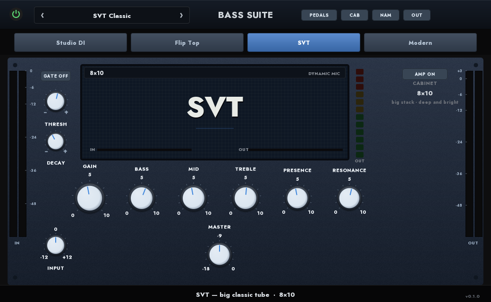
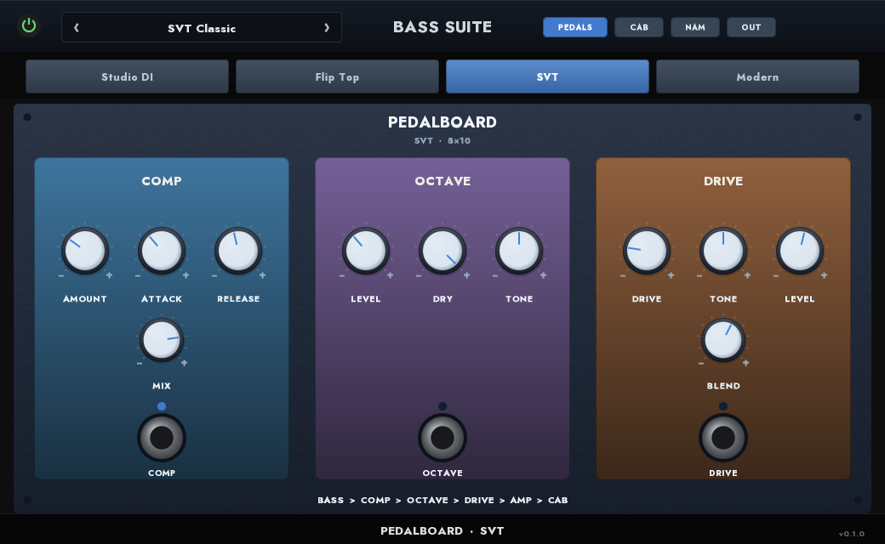
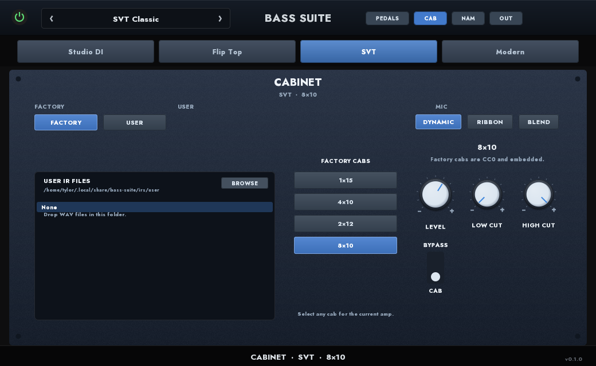
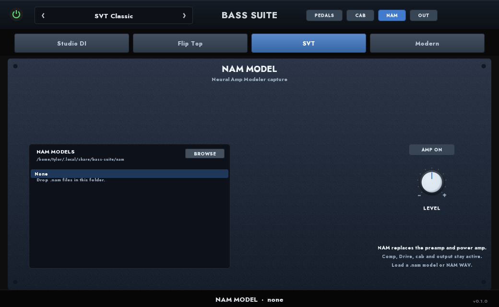
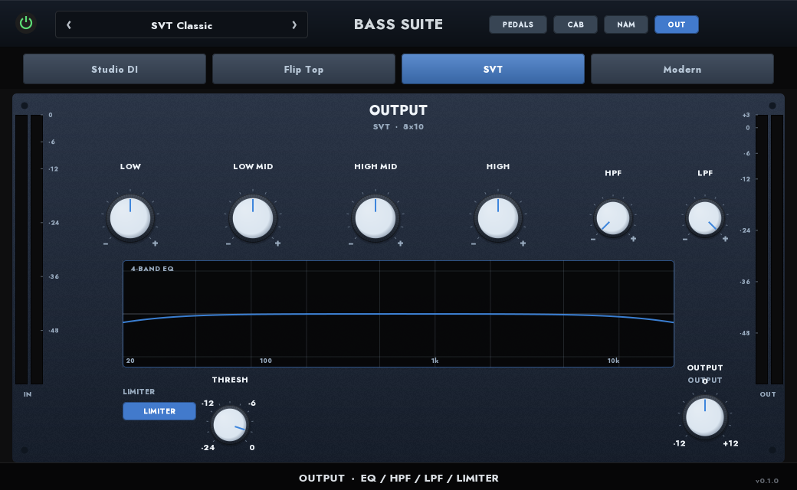

# Bass Suite

**Version 0.1.0 — Linux x86_64** · GPL-3.0-or-later

A bass tracking plugin in the Suite visual language: four bass amps, four
generated CC0 cabinets, a compressor, octave and bass-safe drive, user IRs and
a dedicated NAM capture page in one 1040×640 window.



## Signal flow

```text
bass
  → input trim
  → Comp pedal
  → Octave pedal
  → Drive pedal
  → amp (Studio DI / Flip Top / SVT / Modern)
       or a NAM capture
  → cabinet IR
  → output EQ + HPF/LPF
  → master / output trim
  → limiter
```

## Pages

### AMP

- Amp tabs: **Studio DI**, **Flip Top**, **SVT**, **Modern**.
- Input, Gain, Bass, Mid, Treble, Presence, Resonance, Master, Output.
- Optional gate with threshold and decay.
- Amp bypass and output limiter.
- Cabinet mini-display with the active cab and mic.

The plugin starts on **SVT + 8×10**, the classic big-bass starting point.

### PEDALS



- **Comp:** Amount, Attack, Release, Mix.
- **Octave:** Level, Dry, Tone (classic flip-flop divider).
- **Drive:** Drive, Tone, Level, Blend (parallel clean for low end).
- Fixed order: `COMP → OCTAVE → DRIVE`.

### CAB



- Factory cabs: **1×15**, **4×10**, **2×12**, **8×10**.
- Mic voicings: Dynamic, Ribbon, Blend.
- Level, low cut, high cut, cab bypass.
- User IR folder with an in-plugin browser. Drop WAVs in
  `~/.local/share/bass-suite/irs/user`.

### NAM



- Reuses Amp Suite's Neural Amp Modeler runtime and browser.
- Folder: `~/.local/share/bass-suite/nam`.
- A capture replaces the parametric preamp/power amp; Comp, Drive, cab and
  output remain available.

### OUT



- 4-band output EQ: Low, Low Mid, High Mid, High.
- HPF and LPF with a live response curve.
- Limiter with threshold, plus Output trim and stereo meters.

## Build

Requires CMake 3.16+, a C++17/C++20 compiler, Cairo, FreeType, X11, LV2,
libsamplerate and the bundled NAM runtime.

```sh
cmake -S . -B build -DCMAKE_BUILD_TYPE=Release
cmake --build build -j
ctest --test-dir build --output-on-failure
```

Install for the current user:

```sh
cmake -S . -B build \
  -DCLAP_DIR="$HOME/.clap" \
  -DLV2_DIR="$HOME/.lv2"
cmake --build build -j
cmake --install build
```

## Factory cabinet IRs

The four cabs are original **CC0** minimum-phase IRs generated by
`tools/make_bass_irs.py` from a parametric bass-cab model. No commercial or
reference IR is bundled. See `assets/irs/README.md`.

## Status

0.1.0 is the first working vertical slice:

- 4 amps, 4 cabs, Comp/Octave/Drive, user IRs, NAM, OUT page, CLAP + LV2.
- 1040×640 panel, resizable 0.5×–2×.
- Tests: DSP, panel, layout, geometry, TTL, CLAP and LV2 host tests.
- Unused Amp Suite delay/reverb code and guitar-only parameters removed.

Next:

- Amp voicing pass against reference recordings.
- More preset tuning and additional cabs.
- Optional captures/IR packs.

Known limits:

- The amp voicings are first-pass; the structure is production-ready, the
  values still need a listening pass.
- NAM and user IR files are local only; no models or IRs are bundled.
- The page state is UI-only; parameters and the preset are saved with the host.

## Licence

GPL-3.0-or-later. See `THIRD_PARTY_NOTICES.md`.
